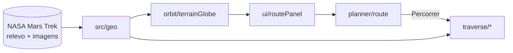
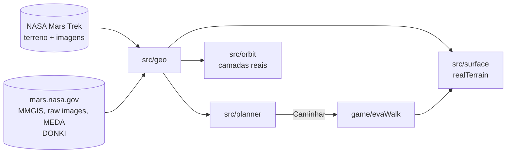
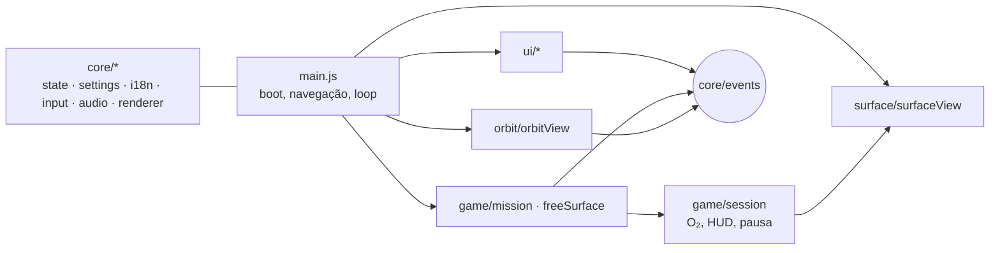

# Arquitetura

## Visão geral (v3.1)

Uma ferramenta só: o **globo** (estado `dashboard`) é onde Marte é explorado e as rotas são planejadas, e a
**primeira pessoa** (estado `surface`) percorre a rota. Estados: `loading → start ⇄ dashboard ⇄ surface`.

- `orbit/terrainGlobe.js` — quadtree de tiles com relevo e imagens reais em streaming (LOD por erro em
  pixels, fila de carregamento por prioridade, cache de texturas, descarte por tempo sem uso). Vértices
  relativos ao centro de cada tile para manter a precisão até o chão; planos de recorte acompanham a altitude.
- `orbit/globeControls.js` — câmera alvo/distância/rumo/inclinação, zoom no cursor, voo com arco.
- `orbit/routeLayer.js` — marcadores e linha da rota sobre o terreno.
- `ui/routePanel.js` — aba "Rota": pontos, cálculo, métricas, exportação, rotas salvas.
- `planner/route.js` — rota entre pontos (grade por trecho, A\*, avaliação da EVA, rádio, sombra).
- `traverse/chunks.js` — blocos de terreno em volta do caminhante (ativos / carregando / descartados).
- `traverse/traverse.js` + `traverseApp.js` — cena, modos seguir/livre, relógio da EVA, HUD (`ui/hud.js`).



## Visão geral (v3)

A versão 3 acrescenta duas camadas ao desenho da v2:

- `src/geo/` — **dados reais**, sem Three.js (funções puras, testadas): geodésia de Marte
  (`mars.js`), matemática de tiles (`tiles.js`), decodificador quantized-mesh (`quantizedMesh.js`),
  grade de altitude e análises — declividade, rugosidade, curvas, perfil, linha de visada, sombras
  (`heightGrid.js`), Mars24 (`mars24.js`), acesso ao Mars Trek no navegador (`trek.js`) e feeds das
  missões (`missionData.js`).
- `src/planner/` — **planejador de EVA**: `site.js` monta um local (grade + foto + rochas),
  `plannerView.js` desenha em 3D, `overlays.js` gera as camadas calculadas, `routing.js` faz o A\*,
  `eva.js` tem o modelo de consumíveis e a nota, `rocks.js` detecta blocos, `plannerApp.js` é a interface.

O estado `planner` entra na máquina de estados (`start ⇄ dashboard ⇄ planner → surface`).
`surfaceView.build({ realSite })` monta a primeira pessoa sobre um `site` real usando
`surface/realTerrain.js`, que tem a mesma interface do terreno gerado (`height`, `gradient`), então
jogador, rochas e objetivos funcionam sem mudanças. O ensaio da EVA fica em `game/evaWalk.js`.



## Visão geral (v2)

Aplicação estática (sem backend) em JavaScript com ES modules, empacotada pelo Vite.
Um único `WebGLRenderer` desenha uma de duas cenas: a **orbital** (globo) ou a de **superfície**
(primeira pessoa). Toda a interface é HTML/CSS por cima do canvas.



## Estados

`core/state.js` define uma máquina de estados com transições permitidas:

```
loading → start ⇄ dashboard
            ↕         ↕
         mission   surface
```

- `start`: tela inicial com o globo ao fundo
- `dashboard`: exploração orbital livre
- `surface`: caminhada livre em um local
- `mission`: missão guiada (capítulos)

`main.js` → `applyStateUI(state)` liga e desliga cada parte da interface para o estado atual.

## Comunicação entre módulos

Os módulos não mexem nas variáveis uns dos outros. A comunicação acontece por:

1. **Funções exportadas** (ex.: `orbitView.focusPoi(id)`, `surfaceView.build(config)`)
2. **Eventos** (`core/events.js`), para assuntos transversais:

| Evento                            | Quem emite          | Quem escuta               |
| --------------------------------- | ------------------- | ------------------------- |
| `state:change`                    | core/state          | tutorial                  |
| `settings:change`                 | core/settings       | main, HUD, dashboard      |
| `language:change`                 | core/i18n           | dashboard, main           |
| `input:action`                    | core/input          | session, main             |
| `input:escape`                    | core/input          | session, main             |
| `input:pointerlock`               | core/input          | session (auto-pausa), HUD |
| `orbit:*`, `measure:update`       | orbit/orbitView     | ui/dashboard              |
| `surface:hazard`, `surface:rover` | surface/surfaceView | HUD, session              |
| `achievement:unlock`              | game/achievements   | main (toast + som)        |
| `log`                             | vários              | ui/dashboard (registro)   |
| `modal:change`                    | ui/modal            | main (bloqueia a entrada) |
| `sound:caption`                   | core/audio          | HUD (legendas de som)     |

## Superfície

`surfaceView.build(config)` monta um "mundo" a partir de uma configuração:

```js
{
  seed, profile, hazards, timeOfDay, hazardIntensity, objective, rover, label;
}
```

- **Terreno** (`terrainModel.js`): função de altura pura e determinística por semente, com
  perfis (`flat`, `dunes`, `channels`, `hill`, `plateau`, `rim`, `crater`, `icy`, `volcano`, `canyon`).
  A área de pouso é sempre plana.
- **Texturas** do chão e das rochas são geradas **uma vez** em um Web Worker e compartilhadas;
  cada perfil só muda a cor do material.
- **Rochas** usam `InstancedMesh` (6 formas × 3 materiais).
- **Descarte**: `disposeWorld()` libera geometrias, materiais e texturas do mundo anterior.
  Recursos compartilhados são marcados com `userData.shared = true` e preservados.
  Há um teste E2E que troca de capítulo várias vezes e verifica que a memória não cresce.

`surfaceView.update(dt)` simula o quadro e **devolve** o que aconteceu (passos, alvo concluído,
perigos, prompt). As regras ficam em `game/session.js` (oxigênio, sons, HUD, pausa) e em
`game/mission.js` / `game/freeSurface.js` (o que fazer ao concluir ou falhar).

## Dados

Todo o conteúdo está em `src/data/*.json`, com textos em `{ "en": "...", "pt": "..." }`.
Os testes conferem que todos os campos estão traduzidos e que as coordenadas são válidas.

- `pois.json`: locais (coordenadas, missão, perigos, recursos, fatores de viabilidade, perfil de superfície)
- `mission.json`: capítulos (objetivo, perigos, hora do dia, narrativa, pergunta de campo)
- `catalog.json`: tipos, camadas, rovers, sondas e conquistas

## Modelos ilustrativos

- `orbit/marsModel.js`: elevação, temperatura, radiação e gelo aproximados a partir das grandes
  feições reais. **Não são dados medidos**, por isso a interface mostra "Ilustrativo".
- Telemetria do painel: valores **simulados** com base em condições típicas de Jezero.
- `game/scoring.js → baseViability`: média ponderada educacional.

## Segurança

- Todo conteúdo dinâmico é inserido como texto (`core/dom.js → h()`), sem `innerHTML`.
- Sem handlers inline no HTML; permite uma CSP rígida.
- CSP injetada no build (`vite.config.js`) e cabeçalhos em `public/_headers`.
- Dependências locais (npm), sem CDN; fontes auto-hospedadas.
- Fotos da NASA: tempo limite, validação do JSON e apenas URLs `https://*.nasa.gov`.
- Links diretos validados por expressão regular.

## Desempenho

- Qualidade automática por dispositivo (`core/quality.js`) com 4 níveis.
- Textura do planeta em WebP (2K = 250 KB, 4K = 0,9 MB, 8K = 2,7 MB) em vez de JPG de 8,4 MB.
- Texturas da superfície em Web Worker; rochas instanciadas; HUD atualizado a ~20 Hz.
- Camadas geradas só quando usadas, e guardadas em cache.
- O loop usa `requestAnimationFrame` (pausa sozinho com a aba oculta); a sessão também pausa.
- Service worker (só em produção) para uso offline.
